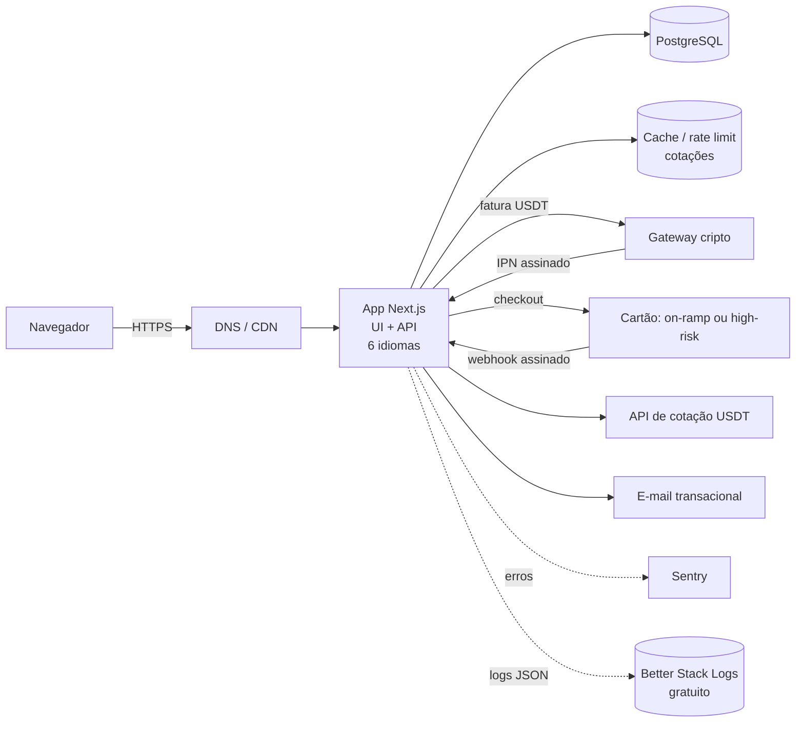
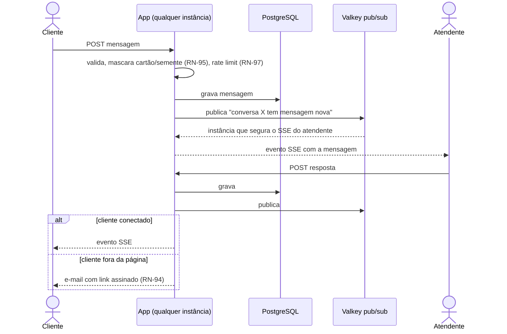

# 04 — Arquitetura

## Visão geral



Observabilidade (erros, logs, alertas, fluxo de bug): [16](16-observabilidade.md).

## Backend

Dentro do próprio Next.js: Server Actions para formulários e Route Handlers para webhooks e cron. Nenhum serviço separado no MVP.

Regra de ouro: **toda decisão de negócio e de permissão acontece no backend.** Preço vem do banco em USDT (RN-12, RN-20); cotação para cartão é travada no servidor (RN-36); pagamento só é confirmado por webhook (RN-32).

### Garantia técnica

- `rules.ts`, `queries.ts`, `src/db/*`, `src/lib/env.ts`, `logger.ts` e `cron.ts` começam com `import "server-only"`: **o build quebra** se um componente de cliente importar qualquer um deles.
- ESLint: arquivos em `src/components/**` e `src/features/*/components/**` não importam `rules`, `queries`, `@/db`, `env`, `logger` nem `cron`. Componente recebe o resultado pronto por props, vindo da página (servidor).

### O front só exibe

Regras com lado visual: **o servidor decide e manda o resultado; o front mostra; o servidor confere de novo na ação** (carrinho, checkout, cupom).

| Regra | Servidor decide | Front só mostra | Servidor confere de novo em |
|-------|-----------------|-----------------|-----------------------------|
| RN-11 esgotado | se o produto/slot tem estoque | botão desabilitado, selo "esgotado" | adicionar ao carrinho e criar o checkout |
| RN-13 / RN-19 catálogo | categorias e produtos ativos | lista vinda do banco | carrinho (produto inativo é recusado) |
| RN-18 estimativa em moeda local | valor ≈ com a cotação em cache — *bloqueado até a API de cotação (#63, #86)* | texto "≈" já calculado | — (nunca usada para cobrar) |
| RN-21–RN-23 promoção | se está ativa agora e o preço final | preço riscado + contagem até `endsAt` enviado pelo servidor | carrinho e checkout (promoção vencida não vale) |
| RN-26 promoção × cupom | qual desconto é maior | "desconto aplicado: …" | checkout (recalcula) |
| RN-36 cotação do cartão | taxa travada por 15 min | contagem de validade | criação do pagamento (cotação vencida é recusada) |
| RN-82 / RN-83 fuso | valida o cookie `tz` (lista IANA) | detecta o fuso no navegador e formata horários com `Intl` | gravação da preferência |
| RN-90 erro | código estável + `requestId` | mensagem traduzida pelo código | — |
| RN-100–RN-103 busca e filtros | resultado, contagem, ordem e paginação (consulta em `catalog/queries.ts`) | campo, painel de filtros, chips dos filtros ativos | cada requisição (URL validada com zod) |
| Listas do admin (#88) | página no banco: pedidos e reportes com `LIMIT/OFFSET` + total (`count(*) over()`), 50 por página; auditoria por cursor (keyset `(created_at, id)`, só cresce) | links de página | cada requisição (página/cursor inválido volta à primeira) |

Validação no formulário (zod no cliente) é só conveniência: o mesmo `schemas.ts` roda de novo no servidor.

## Camadas (regra de dependência — [13 §2](13-padroes-qualidade.md#2-padrões-de-projeto))

```
app/[locale] (rotas, actions, handlers) ──► features/<x> (index.ts) ──► lib (adapters, env)
                                                 │
components (Atomic) ◄────────────────────────────┘   components nunca importam features
```

## Responsabilidades

| Componente | Faz | Não faz |
|------------|-----|---------|
| Página / Server Action / Route Handler | Valida (`schemas.ts`), checa sessão e permissão, chama a feature | Regra de negócio, SQL |
| `features/<x>/rules.ts` | Regras RN puras: **preço final com promoção/cupom (`pricing/rules.ts`)**, preço da variante + adicionais em % (RN-17, #100), vagas, transições do pedido, conversão de fuso | Banco, rede ou framework |
| `features/<x>/queries.ts` | Leitura e escrita no banco da feature | Decidir regra |
| `lib/payments/crypto` e `lib/payments/card` | Adapters `PaymentProvider` (`createCheckout`, `verifyWebhook`, `refund`) | Mudar estado do pedido |
| `lib/rate-limit` + `lib/valkey` | Rate limit compartilhado por IP no proxy e por rota sensível (docs/09 §2) | Guardar estado em memória do processo |
| `lib/fx` | Busca cotação USDT→USD/EUR/moeda local, com cache | Cobrar |
| `lib/logger` | Log JSON com `requestId` e mascaramento ([16 §3](16-observabilidade.md#3-padrão-de-log)) | Decidir o que é dado pessoal na hora: a lista de chaves proibidas é fixa |
| Provedores de pagamento | Fatura cripto, cartão, 3-D Secure, antifraude | — (a loja nunca vê cartão nem chave de carteira — RN-30) |
| Banco | Fonte da verdade de serviços, preços, slots, pedidos e eventos de webhook | — |

## Features

`catalog` (categorias, produtos e variantes — #100), `account` (conta opcional do cliente e personagens salvos — RN-107 a RN-109), `pricing` (promoções, cupons e cálculo do preço final — RN-21 a RN-29), `schedule` (slots de raid), `cart`, `checkout`, `payments`, `orders`, `admin`, `auth`, `preferences` (região, idioma, fuso), `support` (chat de suporte e reportes de bug), `staff` (contas de suporte/admin, papéis, idiomas e horário de atendimento) — os mesmos nomes dos escopos de commit.

## Idioma, fuso e região (RN-14, RN-80 a RN-83)

| Preferência | Detecção automática | Onde fica | Troca |
|-------------|---------------------|-----------|-------|
| Idioma | `Accept-Language` no middleware do next-intl | Segmento da URL `/[locale]` + cookie `NEXT_LOCALE` | Seletor no cabeçalho |
| Fuso | `Intl.DateTimeFormat().resolvedOptions().timeZone` no navegador | Cookie `tz` (+ perfil, se logado) | Seletor no cabeçalho (lista IANA) |
| Região do jogo | — (loja só US, RN-14 / #92) | `products.region` com padrão `US` | Sem seletor |

- Horários guardados em UTC (`timestamptz`); formatação com `Intl.DateTimeFormat` no fuso escolhido — sem biblioteca de datas.
- Primeira renderização sem cookie `tz`: horários renderizados no cliente (evita mostrar fuso errado vindo do servidor).
- URLs: `/en`, `/fr`, `/de`, `/pt-br`, `/zh-hant`, `/zh-hans`; `hreflang` em todas as páginas.
- Código interno do next-intl **igual ao da URL** (`pt-br`, `zh-hant`, `zh-hans`; arquivos `messages/pt-br.json` etc.). `<html lang>` e `Intl` usam o canônico (`pt-BR`, `zh-Hant`) via `canonicalLocale()`. Não usar prefixo diferente do código: o next-intl reescreve a URL e o Next 16 passa a reescrita pelo proxy de novo → laço de redirecionamento (#59).

## Rede

- Banco e cache sem IP público; só rede privada.
- Portas públicas mínimas; SSH só por chave e IP restrito.

## Fluxos principais

### Compra

1. Cliente escolhe o produto e as opções (combinação da variante — #100, adicionais, realm/facção/personagem — ou um personagem salvo, RN-108; horário quando a raid tem agenda) e, se quiser, um cupom.
2. O servidor recalcula o total em USDT a partir do banco (RN-20) e aplica o maior desconto entre promoção e cupom (RN-23, RN-26).
3. "Finalizar": escolhe **USDT** ou **cartão** (RN-35). A action cria o pedido `pendente`, reserva gold/vaga (RN-34) e:
   - USDT: cria fatura no gateway (rede escolhida — RN-37), esvazia o carrinho e redireciona para a fatura; falha do gateway → pedido `expirado` e carrinho intacto;
   - Cartão: trava a cotação por 15 min e cria o checkout (RN-36, RN-38).
4. Webhook/IPN assinado → evento gravado em `payment_events` (RN-33) → pedido `pago` (RN-32) ou `pagamento_parcial` (RN-37).
5. Admin atribui o pedido à equipe → `em_andamento` → registra a prova de entrega → `concluido` (RN-52).
6. Pagamento não confirmado em 30 min → cron marca `expirado` e libera a reserva (RN-34).

Sequência em [06](06-uml.md#3-sequência--compra). Pagamentos em [14](14-pagamentos-internacionais.md).

### Chat de suporte (RN-92 a RN-99)



- A mensagem é gravada **antes** de ser avisada: se o SSE cair, o cliente busca o que perdeu pelo GET das mensagens (a partir do último `id`).
- Conexões SSE longas exigem que proxy/CDN não cortem a resposta: ping a cada 25 s e `Cache-Control: no-cache`.
- Visitante sem conta: cookie `httpOnly` com token aleatório da conversa (guardado só o hash).

## Modelo de dados (resumo)

- `categories` (id, kind `gold|raid|dungeon|pvp|achievement|delve`, name, slug, description, image_url, sort_order, active, deleted_at? (#158: excluir só marca — RN-72)) — RN-13; texto único para todos os idiomas (RN-84)
- `tags` (id, name, slug único global, sort_order, active, deleted_at?, timestamps) e `product_tags` (product_id → products em cascata, tag_id → tags, position — 0 = principal; PK (product_id, tag_id)) — #160: várias tags por produto, no lugar das subcategorias (migrations 0023 copia os dados e 0024 tira `subcategories`/`products.subcategory_id`). Tag desativada/excluída some dos produtos, mas não esconde o produto
- `products` (id, category_id, region (sempre `US` — RN-14), name, slug, description, image_url, price_usdt_cents, unit, addons jsonb `[{name, percent}]` (RN-17), max_quantity, price_on_request (RN-106), hot, sort_order, external_id (importação idempotente), option_axes jsonb `[{name, values[], style: slider|boxes}]` (RN-17, #100), details (descrição detalhada; parágrafos separados por linha em branco), images jsonb `[{src, alt}]` (só arquivos de `public/catalog/`), faq jsonb `[{q, a}]` (#136; validados em `features/catalog/content.ts`; vêm de `scripts/catalog/content.json` até o dashboard editar — #137), active, sales_count, deleted_at? (#158: excluir só marca — RN-72)) — RN-19; índice `pg_trgm` (GIN) em `name` e `description` para a busca (RN-100). Com eixos, `price_usdt_cents` é o "a partir de" (menor combinação ativa), recalculado ao salvar no admin e na importação
- `product_variants` (id, product_id, options jsonb `{eixo: valor}` — único por produto —, price_usdt_cents, price_on_request, note, sort_order (ordem dos eixos), external_id?, active) — #100. Nunca apagada pelo admin: combinação removida da lista fica inativa (carrinhos e pedidos apontam para ela). A importação junta os itens do JSON de origem pelo mapa `scripts/catalog/groups.json`
- `promotions` (id, name, type `percent|fixed`, value, scope `store|category|product`, category_id?, product_id?, starts_at, ends_at, active, deleted_at? (#158: excluir só marca — RN-72)) — RN-21 a RN-24. **Um alvo por registro** (vários alvos = várias promoções; sem tabela `promotion_targets`)
- `coupons` (id, code único (minúsculas), type, value, scope, category_id?, product_id?, starts_at, ends_at, max_uses?, max_uses_per_email?, min_order_usdt_cents, active, deleted_at? (#158: excluir só marca — RN-72)) — RN-25; um alvo por registro. `carts.coupon_code` guarda o cupom digitado, revalidado a cada leitura
- `coupon_redemptions` (coupon_id, order_id único, email, status `reserved|used|released`) — RN-27: reservado no checkout com a linha do cupom travada, `used` quando o IPN leva a `pago`, `released` na expiração
- `audit_log` (id, staff_id, entity `category|product|promotion|coupon`, entity_id, action `create|update|delete`, before jsonb, after jsonb (vazio na exclusão), created_at) — RN-71; gravado na mesma transação da alteração (`saveAudited`; exclusão em `deleteAudited`, que deixa a chave estrangeira recusar o que está em uso — RN-72), só cresce; tela em `/[locale]/admin/auditoria`
- `raid_slots` (id, product_id, region, starts_at timestamptz, capacity, reserved)
- `carts` (id, created_at, updated_at) + `cart_items` (id, cart_id, product_id, raid_slot_id?, variant_id? (#100), quantity > 0, options jsonb) — carrinho do visitante, id em cookie httpOnly (30 dias); **sem preço gravado**: o total é recalculado a cada leitura (RN-20). Regras de preço em `src/features/pricing/rules.ts`: passo do gold (RN-15), preço da variante + adicionais (RN-17, #100)
- `orders` (id, email, locale, status, subtotal_usdt_cents (original), discount_usdt_cents, discount_source `promotion|coupon|none`, discount_ref (id do cupom), total_usdt_cents, payment_method `usdt|card`, network `trc20|erc20`, provider, provider_payment_id, pay_url, paid_usdt_cents, tx_hash, expires_at, created_at, updated_at). Com o cartão (#26) entram quote_rate, charged_amount, charged_currency
- `order_items` (order_id, product_id, raid_slot_id?, variant_id? (#100), product_name (cópia), options jsonb — realm, facção e personagem, combinação escolhida (`variant`, cópia) e adicionais —, unit_price_usdt_cents (original), discount_usdt_cents (promoção da linha), promotion_id?, quantity). Preços e descontos congelados no checkout (RN-29)
- `deliveries` (order_id, staff_id, proof_url (https — print/log; upload de arquivo entra com o storage), note, delivered_at) — RN-52; `orders.assigned_to` = quem iniciou a entrega
- `payment_events` (provider, provider_event_id **único** = `payment_id:status:valor pago`, order_id, type, payment_id, pay_currency, paid_usdt_cents, tx_hash, received_at) — idempotência (RN-33) e conciliação; IPN que não bate com o pedido (rede/valor) fica registrado e sem efeito
- `users`, `sessions`, `accounts` (hash scrypt da senha), `verifications`, `two_factors` (segredo TOTP criptografado) — Better Auth, equipe (convite, RN-04) e cliente com cadastro opcional (RN-107; comprar continua sem conta — RN-01). Sessão de 7 dias; a equipe tem teto de 12 h conferido em `getStaff`. Cadastro só pela action `signUp` (`autoSignIn` ligado desde o #118). `getCustomer` ignora sessão de equipe (RN-110). Sem rota `/api/auth`: login e 2FA rodam em Server Actions via `auth.api`; telemetria do Better Auth desligada. `users.theme?` guarda o tema do cliente (RN-111; validado no app, null = padrão). `users.avatar?` guarda a chave do avatar pronto (#162; vem na sessão pelo `additionalFields` do Better Auth)
- `characters` (id, user_id → users em cascata, realm, faction `alliance|horde`, name, created_at) — RN-108; único por (user_id, lower(realm), lower(name)); até 10 por conta (trava na linha do usuário ao adicionar)
- `orders.user_id?` → users (`set null` ao excluir a conta — RN-109); índice para "minhas compras" (RN-107)
- `access_logs` (occurred_at, ip, port?, user_id?, session_id?, method, route, request_id) — log de acesso legal, 6 meses ([16 §9](16-observabilidade.md#9-log-de-acesso-obrigação-legal))
- `staff_profiles` (user_id, role `suporte|admin`, languages text[], active, invited_by, created_at) — RN-04 a RN-06; clientes não têm linha aqui. Desativar apaga as sessões na hora (RN-05)
- `staff_invites` (id, email, role, languages, token_hash (sha-256), expires_at (7 dias), used_at, invited_by) — RN-04: o link do convite é mostrado uma vez ao admin (e-mail entra com o provedor)
- `support_hours` (weekday 0=domingo, start_min, end_min — minutos UTC; fim < início atravessa a meia-noite) — RN-99; sem linhas = sempre aberto; editado em `/admin/equipe` com auditoria
- Chat — "digitando" (#168): o lado do cliente chama a action `customerTyping` (no máx. 1 vez a cada 3 s, limite `chatTyping` por conversa) que publica `{typing:"customer"}` no canal da conversa; o SSE entrega e só a tela da equipe mostra (some em 4 s ou quando a mensagem chega). A equipe não publica "digitando".
- `support_conversations` (id, user_id? (#162: conversa de quem está logado; `set null` ao excluir a conta), guest_email?, guest_name?, order_id?, locale, status `aberta|em_atendimento|resolvida`, assigned_to?, guest_token_hash?, created_at, last_message_at, resolved_at) — RN-92, RN-93
- `support_messages` (id, conversation_id, author_type `customer|staff|system`, author_id?, body, created_at, read_at) — corpo já mascarado (RN-95)
- `support_attachments` (id, message_id, storage_key, mime, size_bytes) — RN-96
- `bug_reports` (id, description, email?, page, request_id, locale, region, timezone, user_agent, release, status, created_at) — RN-91

## Rotas

| Rota | Tipo | Acesso |
|------|------|--------|
| `/[locale]` | Página | Público |
| `/[locale]/produtos?q=&cat=&min=&max=&disponivel=1&sort=&page=` | Página (busca e filtros — RN-100 a RN-103). Fora de `/wow/` para não colidir com o slug de uma categoria; `promo=1` filtra produtos com promoção valendo; preço mínimo/máximo e ordenação usam o **preço final** (SQL em `catalog/search.ts`, mesma regra de `pricing/rules.ts`) | Público |
| `/[locale]/wow/[categoria]`, `/[locale]/wow/[categoria]/[produto]` (slugs criados pelo admin — RN-13, RN-19; rotas no grupo `app/[locale]/(store)`). Inexistente → página "não encontrada" com `noindex` (status 200 por causa do streaming). #109: clicar no produto abre a **página do produto** com as opções; ao adicionar, a action `addToCart` devolve o carrinho e ele aparece na **barra lateral** (ir ao pagamento ou continuar comprando). "Comprar agora" vai direto para `/carrinho#pagar` (a gaveta por rota interceptada do #102 foi removida a pedido do dono) | Página | Público |
| `/[locale]/carrinho` (carrinho e checkout na mesma página: e-mail, rede e "Pagar com USDT") | Página + Server Actions | Público (visitante — RN-01) |
| `/[locale]/cadastro`, `/[locale]/entrar` | Página + Server Actions | Público (RN-107): 5 cadastros/h por IP, login 10/10 min por IP e por e-mail (`failClosed`); senha vazada recusada (HIBP); o cadastro já entra logado (#118); conta da equipe recusada no login da loja (RN-110); `?voltar=` leva de volta à página anterior depois de entrar/cadastrar/sair (#130) — só caminho interno do idioma atual (`safeNext`, sem open redirect) |
| `/[locale]/conta` | Página + Server Actions | Cliente logado (RN-107 a RN-109): minhas compras, personagens salvos, sair, excluir a conta (pede a senha) |
| `/[locale]/pedido/[id]?t=` | Página | Dono do pedido: link assinado (HMAC do id com `ORDER_LINK_SECRET`); token errado = "não encontrado". Não mostra o e-mail |
| `/[locale]/admin/entrar`, `/[locale]/admin/entrar/codigo`, `/[locale]/admin/2fa` | Página + Server Actions | Login da equipe (senha; código TOTP só para quem ativou o 2FA). Ativar o 2FA é opcional, pelo link "2FA" do painel (RN-02, #116). Conta inicial: `pnpm admin:create <email>` |
| `/[locale]/admin/pedidos`, `/[locale]/admin/pedidos/[id]` | Página + Server Action | Suporte e admin (RN-06): fila "a fazer" (pago, em andamento), iniciar e concluir com prova (RN-52); suporte vê e-mail mascarado e hash curto |
| `/[locale]/admin/*` | Página | Equipe ativa (2FA opcional — RN-02, #116); permissão conferida em cada página e action (`requireStaff`), não no layout |
| `/[locale]/admin/categorias`, `/[locale]/admin/produtos`, `/[locale]/admin/promocoes`, `/[locale]/admin/cupons` | Página + Server Actions | Admin com 2FA (RN-70) |
| `/api/webhooks/crypto`, `/api/webhooks/card` | API | Só assinatura do provedor |
| `/api/cron/expire-orders`, `/api/cron/refresh-fx`, `/api/cron/purge-access-logs` | API | Segredo do cron |
| `/api/search/suggest?q=&locale=` | API (GET) | Público (#110): sugestões da busca, 2+ caracteres, só catálogo ativo; 120/min por IP; `Cache-Control: no-store`; `%` e `_` do termo tratados como texto |
| `/api/health` | API | Público; só status (sem versão de dependências nem dados) — usado pelo Better Stack Uptime |
| `/[locale]/reportar?pagina=&erro=` | Página + Server Action | Público (RN-91): 5/h por IP (`failClosed`) + campo-isca; CAPTCHA entra com a decisão do Turnstile. Link no rodapé e na tela de erro |
| `/[locale]/admin/reportes` | Página + Server Action | Suporte e admin (RN-06); "resolvido" entra na auditoria (RN-07) |
| Abrir conversa e mandar mensagem | Server Actions (`startChat`, `sendChatMessage`, `staffReply`) | Público com rate limit (RN-92, RN-97: 5 conversas/h por IP, 3 abertas por e-mail, 20 mensagens/min por conversa); CAPTCHA com a decisão do Turnstile (#29) |
| `/api/support/conversations/[id]/messages?after=` | API (GET) | Dono da conversa (cookie `chat` com token; só o hash no banco) ou equipe ativa — retomada pelo último `id` |
| `/api/support/conversations/[id]/stream` | API (SSE) | Idem; ping a cada 25 s |
| `/api/support/stream` | — | *Ainda não: a fila `/admin/suporte` atualiza a cada 15 s* |
| `/[locale]/admin/suporte` | Página | Suporte e admin (fila, conversa, dados do pedido) |
| `/[locale]/admin/equipe` | Página + Server Actions | Só admin (convidar, desativar, papéis, idiomas); horário com #30 |
| `/[locale]/admin/convite/[token]` | Página + Server Action | Quem tem o link: cria nome e senha (8+ com maiúscula, minúscula e número — #107; recusa senha vazada — HIBP); 2FA no primeiro login |
| `/[locale]/admin/docs`, `/[locale]/admin/docs/[slug]` | Página | Admin e suporte (RN-74); lê `docs/*.md` incluídos no build (`outputFileTracingIncludes`) — sem cópia; visitante e cliente recebem 404; Markdown mostrado como texto (renderizar exige dependência nova) |
| `/[locale]/admin/bug-reports` | Página | Admin |
