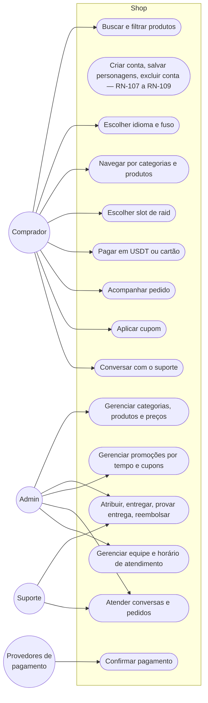
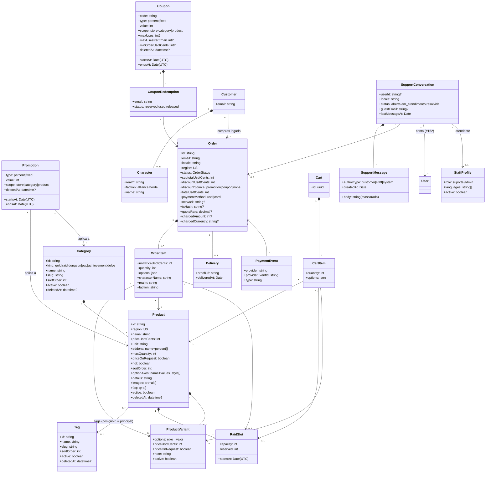
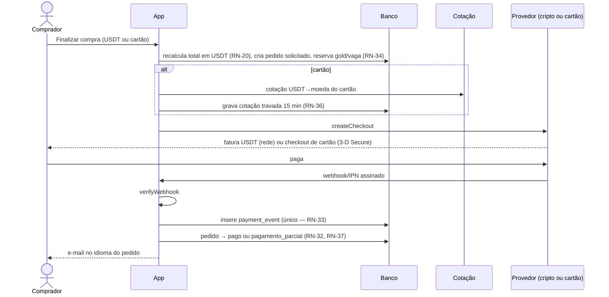
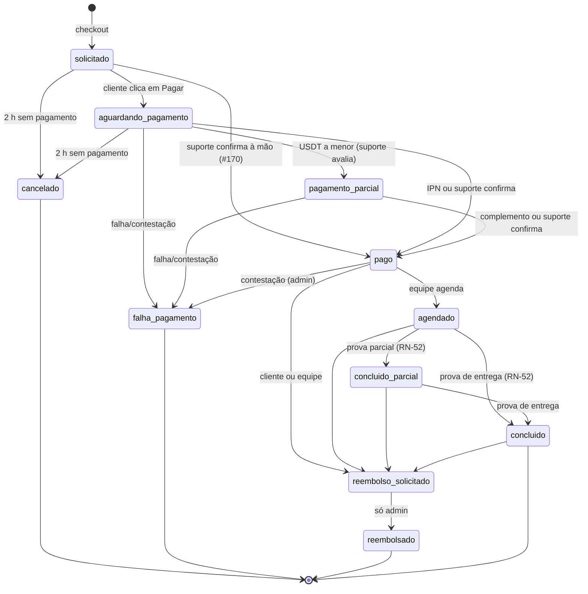
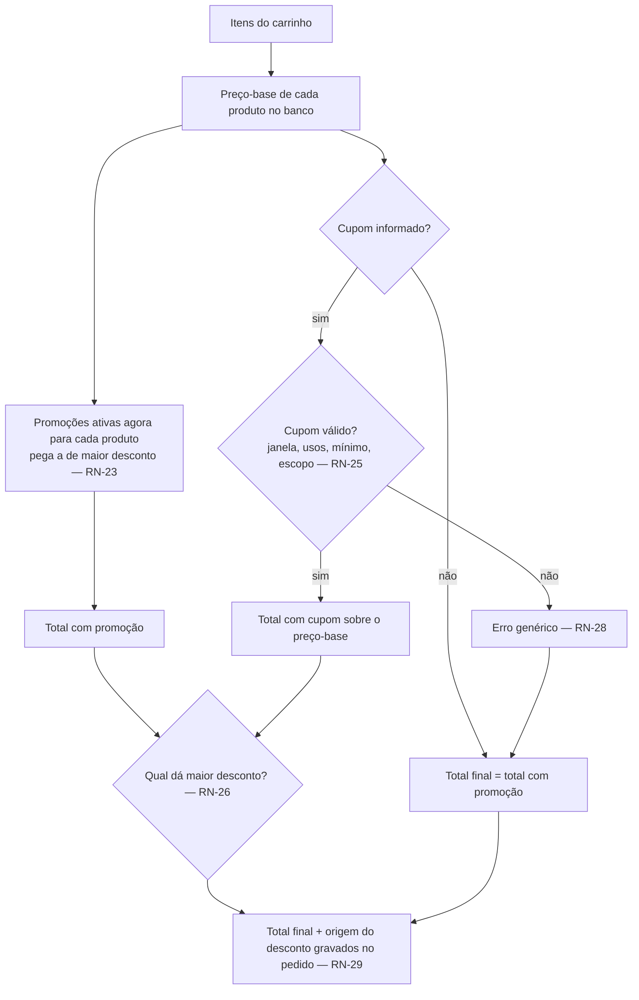
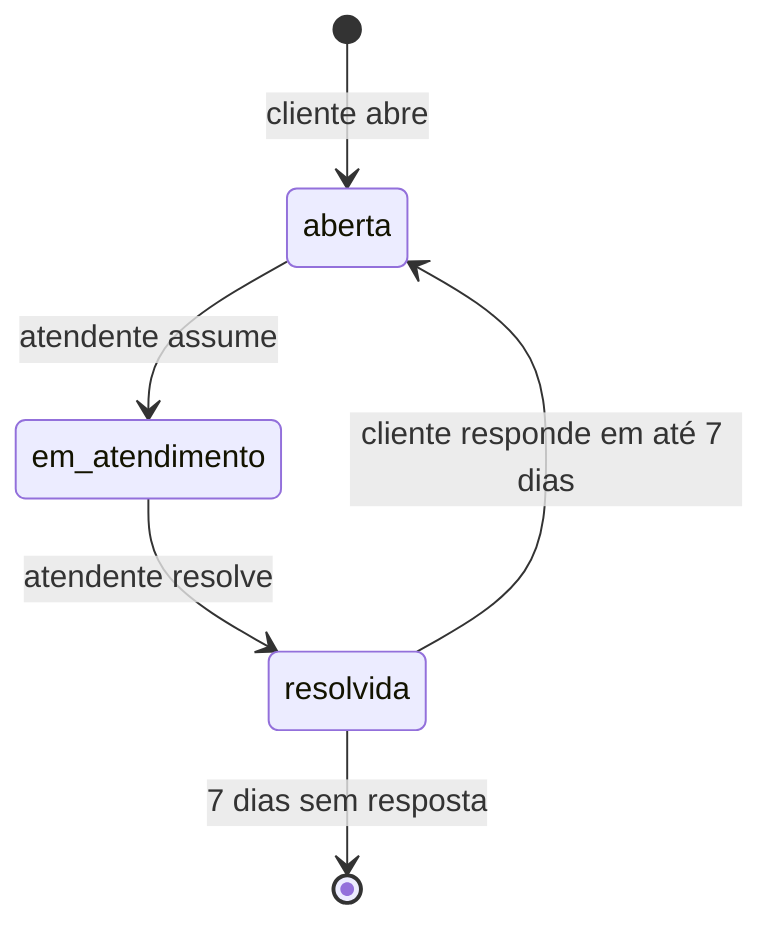
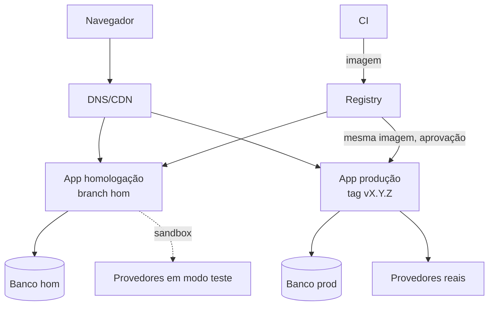

# 06 — UML

Diagramas em Mermaid. Atualize junto com qualquer mudança em [02](02-regras-de-negocio.md) ou [04](04-arquitetura.md).

## 1. Casos de uso

## 2. Classes (domínio)

## 3. Sequência — compra

## 4. Estados — pedido (RN-50, RN-51)

## 4b. Atividade — preço final (RN-20 a RN-29)

## 4c. Estados — conversa de suporte (RN-93)

## 5. Implantação

