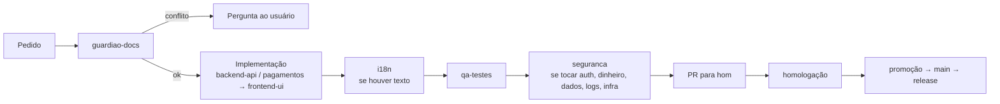
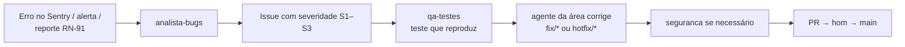

# 12 — Agentes de desenvolvimento

Subagentes do Claude Code em [`.claude/agents/`](../.claude/agents/). Cada um tem escopo estreito, lê os docs da sua área e segue a checagem de conformidade do [CLAUDE.md](../CLAUDE.md).

## Equipe

| Agente | Papel | Escreve código? | Modelo | Docs principais |
|--------|-------|-----------------|--------|-----------------|
| `guardiao-docs` | Confere pedido/diff contra os docs; aponta conflito com o ID da regra e indica os agentes | Não | opus | todos |
| `frontend-ui` | Componentes Atomic Design, páginas `/[locale]`, tema escuro (Enfhess), seletores, vitrine | Sim | sonnet | 11, 15, 02 |
| `backend-api` | Actions, rotas, banco, auth, `rules.ts` (preço, M+, slots, pedido), reservas, cron, admin, reportes | Sim | sonnet | 02, 04, 06, 09, 16 |
| `pagamentos` | USDT, cartão, cotação, webhooks/IPN, parcial, reembolso, chargeback | Sim | opus | 14, 02 (RN-30–38), 09 |
| `i18n` | 6 idiomas, termos de WoW por idioma, fuso, `hreflang`, checagem de chaves | Sim (traduções e config) | sonnet | 02 (RN-80–83), 04, 11 |
| `infra` | Terraform, Docker, CI/CD branch → `hom` → `main`, release-please, Sentry, logs, alertas | Sim | sonnet | 13, 05, 16 |
| `seguranca` | Revisão de segurança, `pnpm audit` | Não | opus | 09, 14, 16 |
| `qa-testes` | Testes unitários, integração, E2E (6 idiomas, fusos), casos de abuso | Só testes | sonnet | 13 §8, 08, 09 |
| `analista-bugs` | Analisa Sentry, logs e reportes; causa provável, severidade S1–S3, issue | Não | opus | 16 |

Modelo `opus` onde errar custa caro (conformidade, dinheiro, segurança, diagnóstico); `sonnet` na implementação do dia a dia.

## Fluxo por tarefa

- Tarefas que atravessam camadas: backend (contrato da API) primeiro, depois UI, depois traduções.
- Tudo que toca `checkout`, `src/lib/payments`, `src/lib/fx` ou `/api/webhooks/*` é do `pagamentos` e passa **sempre** pelo `seguranca`.
- Mudança em CI, deploy, branches ou observabilidade é do `infra`.

## Fluxo de bug

## Regras comuns

- `guardiao-docs`, `seguranca` e `analista-bugs` só leem.
- Nenhum agente faz commit/push sem pedido; commits nunca têm IA como coautora.
- Nenhum agente mexe em produção ou roda `terraform apply` sem confirmação explícita do usuário.
- Agente novo só quando surgir uma área técnica própria; registrar aqui e no `.claude/agents/`.
