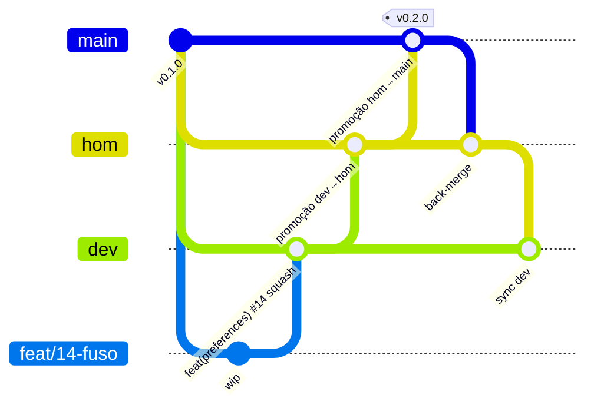
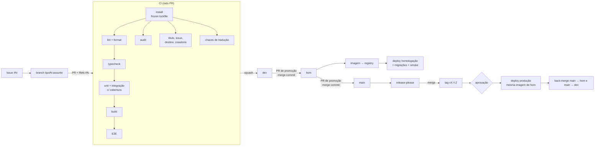

# 13 — Padrões de código e qualidade

Regras obrigatórias para todo código. Valem para pessoas e agentes. O que dá para automatizar é automatizado; o resto é checado no PR.

## 1. Clean code

### Idioma
- **Código em inglês** (variáveis, funções, arquivos, tabelas).
- **Textos da interface** nos 6 idiomas do projeto (`en` padrão, `fr`, `de`, `pt-BR`, `zh-Hant`, `zh-Hans` — RN-80), em `messages/<locale>.json` por namespace de feature. **Proibido texto fixo em componente** (ESLint `i18next/no-literal-string` ou equivalente). Toda chave nova entra em todos os idiomas no mesmo PR; o CI falha se faltar.
- Commits, PRs e docs em português.

| Regra | Como é garantida |
|-------|------------------|
| TypeScript `strict`; proibido `any` (use `unknown` + validação) | `tsc`, ESLint |
| Nomes que dizem a intenção; booleanos com `is/has/can` | Revisão |
| Funções pequenas, retorno antecipado | ESLint `max-depth: 3`, `complexity: 10` |
| Sem número mágico: limites vêm de configuração ou constantes nomeadas | Revisão |
| Comentário só para o **por quê** | Revisão |
| Sem código morto/comentado, sem `console.log` (use o `logger`) | ESLint |
| Arquivo > ~300 linhas → dividir; um componente por arquivo | Revisão |
| Sem import circular | ESLint `import/no-cycle` |
| Abstração só na **terceira** repetição | Revisão |
| Reuso de componentes: estilo no componente, `className` na chamada só para layout ([11 §6](11-design.md#6-reuso-de-componentes-obrigatório)) | CI + revisão |
| Erro tratado explicitamente; nada de `catch {}` vazio | ESLint `no-empty` |
| Formatação | Prettier |

## 2. Padrões de projeto

| Padrão | Onde | Por quê |
|--------|------|---------|
| **Feature folders** | `src/features/<x>/` | Tudo de uma funcionalidade junto |
| **Regras como funções puras** | `features/<x>/rules.ts` | Testáveis sem banco/rede; citam o ID RN |
| **Controller fino** | Route Handlers e Server Actions | Só validam (zod), checam sessão e chamam a feature |
| **Consultas por feature** | `features/<x>/queries.ts` | O ORM já é a abstração: **sem Repository genérico** |
| **Adapter** | `src/lib/*` | Isola serviços externos. **Sem implementação fake no código da aplicação**: sem o provedor configurado a ação é bloqueada com o aviso "API ainda não implementada" (#86). Dublês só dentro de `tests/` |
| **Configuração como dado** | ex.: `plans.ts` | Nada de `if (plan === 'x')` espalhado |
| **Idempotência** | Webhooks | Evento repetido não duplica efeito |
| **Erros com código estável** | `{ error: { code, message, requestId } }` | Front reage por código; usuário vê o ID do erro (RN-90) |
| **Logger estruturado** | `src/lib/logger.ts` (pino) | Único jeito de logar; JSON com `requestId` e `event` ([16 §3](16-observabilidade.md#3-padrão-de-log)) |
| **Atomic Design** + variantes `cva` | Componentes | Reuso e consistência |
| **Schemas na borda** | `features/<x>/schemas.ts` (zod) | Mesmo schema valida form, Server Action e Route Handler |
| **Máquina de estados** | `features/orders/rules.ts` | Transições do pedido (RN-50) num só lugar; transição inválida é erro |
| **Adapter de pagamento** | `src/lib/payments/{crypto,card}` | Interface `PaymentProvider`; cada provedor é uma implementação real; sem chave → checkout bloqueado e webhook 501 |

### SOLID (aplicado sem cerimônia)

| Princípio | Como aparece aqui | Limite |
|-----------|-------------------|--------|
| **S** — responsabilidade única | `rules.ts` decide, `queries.ts` acessa banco, rota só valida e chama | Não criar classe por verbo |
| **O** — aberto/fechado | Variantes `cva`; planos, fretes e provedores como dado (configuração) | Sem sistema de plugins "para o futuro" |
| **L** — substituição | Cada provedor real implementa a mesma interface e passa nos mesmos testes | — |
| **I** — interfaces enxutas | Adapter expõe só o que a loja usa (`createCheckout`, `verifyWebhook`, `refund`) | — |
| **D** — inversão de dependência | `rules.ts` não importa framework, banco nem rede; features dependem da interface do adapter, não do SDK | Só onde há serviço externo; ORM direto em `queries.ts` (sem Repository genérico) |

### Regra de dependência

```
app (rotas) ──► features ──► db ──► lib
                   │
components ◄───────┘   (components nunca importam features)
```

- `rules.ts` não importa framework, banco nem rede, e começa com `import "server-only"` (assim como `queries.ts` e `src/db`): o build quebra se um componente de cliente importar uma regra ([04 — Garantia técnica](04-arquitetura.md#garantia-técnica)).
- Componentes não importam `rules`, `queries`, `@/db` nem segredos (ESLint): recebem o resultado por props.
- Feature importa outra só por `index.ts`.
- Garantido por **eslint-plugin-boundaries**.

## 3. Commits semânticos

[Conventional Commits](https://www.conventionalcommits.org/pt-br/):

```
<tipo>(<escopo>): <descrição no imperativo, minúscula, sem ponto>

[corpo: o porquê]

[rodapé: BREAKING CHANGE: ..., Refs: #123]
```

| Tipo | Uso | Versão |
|------|-----|--------|
| `feat` | Funcionalidade nova | MINOR |
| `fix` | Correção | PATCH |
| `perf` | Desempenho | PATCH |
| `refactor` | Sem mudar comportamento | — |
| `test`, `docs`, `style`, `build`, `ci`, `chore` | — | — |
| `feat!` / `BREAKING CHANGE:` | Quebra de compatibilidade | MAJOR |

Escopos permitidos: `auth`, `ui`, `db`, `infra`, `deps`, `docs`, `catalog`, `pricing`, `schedule`, `cart`, `checkout`, `payments`, `orders`, `admin`, `preferences`, `i18n`, `support`, `observability`.

**Proibido:** `Co-Authored-By` ou atribuição a IA. Bloqueado pelo hook `commit-msg`.

## 4. Husky

| Hook | Roda | Tempo alvo |
|------|------|-----------|
| `pre-commit` | lint-staged: ESLint `--fix` + Prettier nos arquivos alterados | < 5 s |
| `commit-msg` | commitlint + bloqueio de coautoria de IA | < 1 s |
| `pre-push` | `pnpm typecheck && pnpm test --run` | < 60 s |

`.husky/commit-msg`:

```sh
pnpm exec commitlint --edit "$1"
if grep -qiE '^co-authored-by:.*(claude|anthropic|copilot|openai|chatgpt|gpt|gemini)' "$1"; then
  echo "Commits não podem ter IA como coautora (CONTRIBUTING.md)." >&2
  exit 1
fi
```

`commitlint.config.mjs`:

```js
export default {
  extends: ["@commitlint/config-conventional"],
  rules: {
    "scope-enum": [2, "always", ["auth", "ui", "db", "infra", "deps", "docs", "catalog", "pricing", "schedule", "cart", "checkout", "payments", "orders", "admin", "preferences", "i18n", "support", "observability"]],
    // subject-case: o padrão do config-conventional já proíbe começar com maiúscula
    // e aceita nomes próprios no meio ("integrar Stripe"); "lower-case" os recusaria.
  },
};
```

O CI repete tudo; `--no-verify` não fura a regra.

## 5. Tarefas, branches e PRs

**Toda tarefa nasce de uma issue** e segue o fluxo **issue → branch da tarefa → `dev` → `hom` → `main` (prod)**.

### Issue

- Criada com o template `tarefa` (ou `bug`), com marco da fase (`F0`…`F5`), regras RN e critério "pronto quando".
- Sem issue, não há branch nem PR. Exceções automáticas: Dependabot, release-please e back-merge.
- Tarefa que depende de decisão do dono recebe a label `decisao` e não começa antes da resposta.
- **A issue acompanha o código até produção** (workflow `issues.yml`, a cada push):

| O trabalho chegou em | Label da issue | Issue |
|----------------------|----------------|-------|
| `dev` | `dev` | aberta |
| `hom` | `hom` (sai `dev`) | aberta |
| `main` | `prod` (saem `dev` e `hom`) | **fechada** |

  O workflow acha a issue pelos `Refs #<nº>` nas mensagens dos commits que chegaram na branch. Issue já fechada (em produção) não é remarcada pelos back-merges.

### Branches

| Branch | Papel | Criada de | PR para | Merge | Deploy |
|--------|-------|-----------|---------|-------|--------|
| `<tipo>/<nº-da-issue>-<assunto>` (ex.: `feat/14-seletor-de-fuso`) | Tarefa, curta (< 3 dias) | `dev` | `dev` | **Squash** (1 commit semântico por issue) | — |
| `dev` (**padrão do repositório**) | Integração das tarefas | — | `hom` | **Merge commit** | Nenhum (só CI) |
| `hom` | Homologação | — | `main` | **Merge commit** | Automático em homologação |
| `main` | Produção | — | — | — | Tag `vX.Y.Z` → produção com aprovação |
| `hotfix/<nº>-<assunto>` | Bug S1 ([16 §5](16-observabilidade.md#5-fluxo-de-um-bug)) | `main` | `main` | Squash | Produção; depois back-merge |

`<tipo>` = tipo do Conventional Commit: `feat`, `fix`, `docs`, `refactor`, `test`, `chore`, `ci`, `perf`, `build`.



### Regras

- PR para `dev`: corpo com **`Refs #<nº>`** (checado no CI). **Proibido `Closes`/`Fixes`/`Resolves`**: como `dev` é a branch padrão, o GitHub fecharia a issue antes de ela chegar em produção.
- PR para `hom`: só de `dev` (ou back-merge vindo de `main`). PR para `main`: só de `hom`, `hotfix/*` ou release-please (checado no CI).
- Promoções (`dev → hom`, `hom → main`) e back-merges usam **merge commit**, nunca squash: o changelog depende dos commits semânticos de cada tarefa.
- Depois de toda release ou hotfix, **back-merge automático**: PRs `main → hom` e `main → dev`.
- Título do PR em Conventional Commits (checado no CI); PR < 400 linhas alteradas (sem lockfile e migrações geradas).
- Template de PR com checklist; 1 revisão + agente `seguranca` quando tocar auth, dados ou infra.
- **Push direto em `dev`, `hom` e `main` é proibido.** O repositório é privado no plano gratuito, que não tem proteção de branch: a regra vale por disciplina e pelos checks do CI. Com GitHub Pro, ativar rulesets nas três branches.

## 6. SemVer e changelog

- `MAJOR.MINOR.PATCH`; `0.x` no MVP; `1.0.0` no lançamento público.
- **release-please** roda na `main`: lê os commits semânticos que chegaram por `dev → hom`, mantém o Release PR com versão e `CHANGELOG.md`; o merge cria tag, release e dispara produção.
- Configuração `bump-minor-pre-major: true`, para que `feat!` em `0.x` suba o MINOR e não pule para `1.0.0` sem querer.
- `CHANGELOG.md` gerado, nunca editado à mão.

## 7. CI/CD



| Gatilho | Jobs | Bloqueia merge? |
|---------|------|-----------------|
| PR para `dev` | install, lint, format, typecheck, traduções, testes, cobertura, build, E2E, audit, título semântico, `Refs #N` (sem palavra que fecha issue), commits sem coautoria de IA | Sim |
| PR `dev` → `hom` | mesmos jobs + destino permitido | Sim |
| Push em `dev`, `hom` ou `main` | label `dev`/`hom`/`prod` nas issues; fecha em `main` | — |
| Merge em `hom` | imagem, deploy em homologação, migrações, smoke | — |
| PR `hom` → `main` | mesmos jobs + destino permitido + smoke de homologação verde | Sim |
| Merge do Release PR na `main` | tag, produção com aprovação manual (promove a imagem testada em hom), smoke, back-merge para `hom` e `dev` | — |
| PR com `infra/` | `terraform fmt -check`, `validate`, `plan` | Sim |
| Semanal | rebuild de imagens, audit, Dependabot (PRs para `dev`) | — |

Falha de infraestrutura do runner (rede, espelho do apt) não é falha do código (#175): o passo do navegador do Playwright tenta 3x com espera e, se o apt continuar fora, instala só o Chromium e avisa no log. Nunca se faz merge com check vermelho; o caminho é rodar de novo (`gh run rerun --failed`).

Rollback: redeploy da tag anterior. Produção só recebe imagem que passou por homologação (exceção: `hotfix/*`, com smoke antes). Migrações compatíveis com a versão anterior (expandir → migrar → contrair).

## 8. Testes

| Camada | Ferramenta | Cobre | Banco/rede |
|--------|-----------|-------|-----------|
| Unitário | Vitest | `rules.ts`, utilitários, componentes | Nenhum |
| Integração | Vitest | Route Handlers / Server Actions | Banco e cache **reais** (containers); externos com *fakes* |
| E2E | Playwright | Caminhos críticos e casos de abuso, em 390×844 e 1440×900 | App completa |

- Toda regra RN tem teste com o ID: `it('RN-03: ...')`.
- **TDD em `rules.ts`**.
- Bug corrigido = teste que o reproduz; PR cita a issue (`Fixes #123`). Fluxo completo em [16 §5](16-observabilidade.md#5-fluxo-de-um-bug).
- Cobertura: **100 % de branches em `rules.ts`**, **80 % de linhas** em `src/features`.
- Não mockar o banco; *factories* para dados de teste; testes independentes.

## 9. Definição de pronto (todo PR)

- [ ] Conformidade checada; docs atualizados se a regra mudou
- [ ] CI verde
- [ ] Testes novos (com ID RN)
- [ ] Sem segredo, `console.log`, `any`, código comentado
- [ ] Migração compatível
- [ ] Acessível e responsivo
- [ ] Textos em todos os idiomas
- [ ] Título semântico; nenhum commit com IA coautora
- [ ] Issue linkada (`Refs #N`); PR para `dev` (ou `hom`/`main` só em promoção/hotfix)

## 10. Ferramentas (versões fixadas)

Node.js LTS (`.nvmrc`, `engines`), pnpm (`packageManager`), ESLint flat config + `typescript-eslint` + `boundaries` + `import` + `jsx-a11y`, Prettier + `prettier-plugin-tailwindcss`, Husky + lint-staged + commitlint, release-please, Vitest + Testing Library + Playwright, Dependabot, `.editorconfig`.
