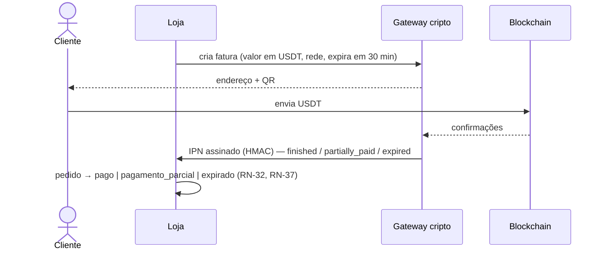

# 14 — Pagamentos (USDT + cartão)

*Pesquisa inicial (2026-11). Taxas, termos e regulação mudam: **confirmar na fonte oficial antes de contratar**.*

Decisão (RN-35): **preço-base em USDT**; cliente paga em **USDT (cripto)** ou **cartão**.

## 1. Restrição principal: provedores comuns não aceitam este negócio

- **Stripe** proíbe venda de moeda/itens de jogo quando a loja não é a operadora do jogo. Boosting não aparece explicitamente, mas o risco de bloqueio é alto. **Stripe sai da stack.**
- **PayPal** tem restrição parecida e alto índice de disputa nesse setor.
- Conta bloqueada = saldo retido por meses. Por isso: provedor que **declara aceitar** "in-game currency / gaming services / RMT" por escrito, antes de integrar.

## 2. USDT (cripto)

| Gateway | Taxa (fontes secundárias) | Observação |
|---------|---------------------------|------------|
| **NOWPayments** | ~0,5% (mesma moeda) / ~1% (com conversão) | Muitas redes de USDT; IPN com HMAC; oferece compra de cripto com cartão via parceiros (ver §3B) |
| CoinPayments | ~0,5% | Antigo no mercado |
| Plisio, CoinGate | ~0,5–1% | Alternativas |
| BTCPay Server | 0% (auto-hospedado) | Você opera o servidor e a carteira; mais trabalho |

- **Redes:** TRC-20 (taxa de rede baixa, mais usada) e ERC-20 (mais cara). Rede errada = dinheiro perdido: a fatura deve mostrar a rede em destaque.
- **Sem chargeback** — principal vantagem.
- **Sugestão:** NOWPayments para o MVP, porque cobre USDT e tem caminho para cartão.

## 3. Cartão

Duas formas, em ordem de preferência:

**A. Processador "high-risk" de cartão** que aceite gaming/RMT. Cobra em USD/EUR o equivalente ao preço em USDT (RN-36), com 3-D Secure (RN-38).
- Esperar: taxa de 4–8%, reserva (*rolling reserve*) de 5–10% por alguns meses, análise do site antes de aprovar (exige Termos, política de reembolso e prazo de entrega claros).
- Candidatos a pesquisar e **confirmar por escrito** que aceitam o setor: processadores de gaming e agregadores de alto risco. *(nenhum verificado ainda)*

**B. On-ramp cripto (cartão → USDT)**: o cliente paga com cartão num parceiro do gateway, que converte e entrega USDT para a loja. A loja só recebe cripto.
- Vantagem: a loja não tem conta de cartão a perder; chargeback é problema do parceiro.
- Desvantagem: KYC do cliente no parceiro, taxa maior para ele, recusa de alguns bancos.

**Sugestão:** começar com **B** (sai junto com o gateway cripto) e avaliar **A** quando houver volume.

## 4. Cotação (RN-36)

- Fonte de cotação USDT→USD/EUR: a do próprio provedor (quando ele cobra) ou uma API pública de preço; guardar no pedido `quote_rate`, `quote_at`, `charged_amount`, `charged_currency`.
- Cotação travada por 15 min; depois disso o checkout pede nova cotação.
- Estimativa em moeda local na vitrine (RN-18) usa cotação em cache de até 1 h; nunca usada para cobrar.

## 5. Brasil: regulação e impostos (confirmar com contador)

- A loja **recebe** cripto como pagamento por meio de um gateway; quem custodia e converte é o gateway. As regras do Banco Central para prestadoras de serviços de ativos virtuais (Resoluções BCB 519–521/2025, vigentes desde 02/02/2026) se aplicam a **essas prestadoras**, não à loja — mas o gateway escolhido pode exigir KYC da empresa.
- Venda para estrangeiro pago em cripto pode ter tratamento de câmbio/exportação de serviço: definir com contador como emitir nota e declarar.
- Declaração de criptoativos à Receita Federal: verificar obrigação vigente com contador.
- Precisa de CNPJ; MEI provavelmente não cobre a atividade nem o faturamento esperado.

## 6. Impactos técnicos

- Preço em `price_usdt_cents` (RN-12); total recalculado no servidor (RN-20).
- Adapter `PaymentProvider` com duas implementações: `crypto` e `card` (ou on-ramp) — features não conhecem o SDK ([13 §2](13-padroes-qualidade.md#2-padrões-de-projeto)).
- Webhook/IPN: verificar assinatura, gravar evento único (RN-33), tratar `partially_paid` e `expired`.
- Pedido guarda: método, rede (USDT), hash da transação, cotação e valor cobrado — **nunca** dados do cartão ou chave de carteira.

## 7. Pendências

- [ ] Confirmar por escrito com NOWPayments (ou alternativa) que aceitam venda de gold/boosting.
- [ ] Escolher a forma de cartão (on-ramp ou processador high-risk) e confirmar aceitação do setor.
- [ ] Contador: CNPJ/CNAE, nota fiscal, declaração de cripto.
- [ ] Advogado: Termos, política de reembolso, lista de países bloqueados.

## Fontes

- [Stripe — restricted businesses](https://stripe.com/us/restricted-businesses/) e [registro da cláusula de moeda de jogo (ConductAtlas)](https://conductatlas.com/platform/stripe/stripe-restricted-businesses-list/provision/CA-P-065553/in-game-currency-sales-operator-restriction/)
- [Marix — Stripe e produtos digitais de alto risco](https://marix.app/library/guides/stripe-digital-products-high-risk)
- [Comparativo de gateways cripto 2026 (Plisio)](https://plisio.net/crypto/best-crypto-payment-gateways) e [taxas comparadas (Aurpay)](https://aurpay.net/aurspace/crypto-payment-gateway-fees-compared-2026/)
- [NOWPayments — USDT TRC-20 (Decrypt)](https://decrypt.co/357458/nowpayments-offers-zero-network-fees-on-usdt-trc20-payments-for-new-users)
- [BC regulamenta criptoativos (Forbes)](https://forbes.com.br/forbes-money/2025/11/bc-regulamenta-mercado-de-criptoativos-e-diz-que-normas-coibem-fraudes-e-lavagem-de-dinheiro/) e [prioridades do BCB 2026 (Capital Aberto)](https://capitalaberto.com.br/artigos/2026/03/novo-marco-regulatorio-e-contabil-das-psavs-prioridades-do-bcb)
