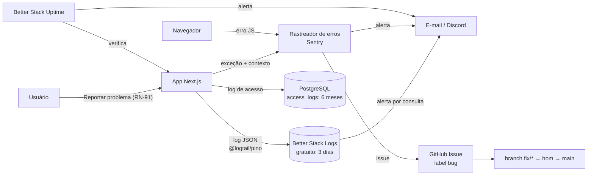
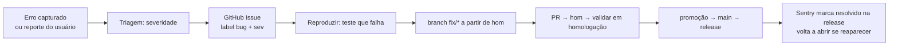

# 16 — Observabilidade: análise de bugs e logs

Objetivo: todo erro é **capturado, salvo, encontrável e rastreável até a correção**, sem gravar dados pessoais.

## 1. Visão geral



## 2. Peças

| Peça | Escolha | Faz | Custo |
|------|---------|-----|-------|
| Logger | **pino** (JSON) em `src/lib/logger.ts` | Log estruturado com níveis, `requestId` e mascaramento | R$ 0 |
| Rastreador de erros | **Sentry** (`@sentry/nextjs`) *(proposta — confirmar)* | Agrupa erros do servidor e do navegador, stack trace com source maps, release = tag `vX.Y.Z`, ambiente `homologacao`/`production` | Plano gratuito no início; pago quando passar do limite (confirmar valor na tabela oficial) |
| Logs da aplicação | **Better Stack Logs, plano gratuito** — transport oficial `@logtail/pino` (pino ≥ 7); uma *source* por ambiente | Busca e alerta para depurar; retenção de **3 dias** | US$ 0 (ver §8) |
| Log de acesso | **Tabela `access_logs` no PostgreSQL** | Guarda o registro exigido por lei por **6 meses** (Marco Civil art. 15) — ver §9 | R$ 0 (espaço no banco) |
| Uptime | **Better Stack Uptime** | Verifica a home e `/api/health` de fora, a cada minuto; página de status | Plano gratuito no início (confirmar limites) |
| Alerta | Regras do Sentry + alertas por consulta no Better Stack | Avisa erro novo, pico de erros, falha de webhook e site fora do ar | R$ 0 |
| Fila de bugs | **GitHub Issues** com label `bug` (integração Sentry → GitHub) | Cada bug vira issue rastreável até o PR | R$ 0 |

Alternativa sem SaaS de erros: **GlitchTip** (compatível com o SDK do Sentry), auto-hospedado.

## 3. Padrão de log

Todo log é uma linha JSON:

```json
{
  "level": "error",
  "time": "2026-11-06T18:22:10.123Z",
  "env": "production",
  "release": "v0.4.1",
  "requestId": "01JC…",
  "route": "/api/webhooks/crypto",
  "feature": "payments",
  "event": "webhook.signature_invalid",
  "orderId": "ord_…",
  "durationMs": 42,
  "err": { "type": "SignatureError", "message": "…", "stack": "…" }
}
```

| Regra | Detalhe |
|-------|---------|
| Níveis | `fatal` (app caiu) · `error` (falhou, precisa de ação) · `warn` (anormal, mas tratado) · `info` (evento de negócio) · `debug` (só local/homologação) |
| `requestId` | Gerado em `src/proxy.ts` em toda requisição (o `x-request-id` vindo do cliente é ignorado), repassado à app e devolvido no header `x-request-id`. No servidor: `logger.child({ requestId: getRequestId(await headers()) })` (`src/lib/request-id.ts`). Presente em todo log e evento do Sentry |
| `event` | Nome estável `dominio.acao_resultado` (ex.: `order.paid`, `checkout.quote_expired`) — dá para buscar e criar alerta |
| Eventos obrigatórios (`info`) | pedido criado/pago/expirado/concluído, webhook recebido/duplicado/inválido, cotação travada, login de admin, mudança de preço, promoção criada/alterada, cupom criado/aplicado/rejeitado, conversa aberta/assumida/resolvida, convite de equipe enviado/aceito, conta de equipe desativada |
| Proibido logar | **corpo de mensagem do chat**, senha, token, cookie, header `Authorization`, dados de cartão, chave/seed de carteira, e-mail completo, IP fora do log de acesso (ver [09](09-seguranca-privacidade.md)) |
| Mascaramento | `redact` do pino nas chaves proibidas; e-mail como `j***@d***.com` |
| Produção | nível mínimo `info`; homologação `debug` |

## 4. Captura de erros

- Servidor: `instrumentation.ts` + `onRequestError` do Next.js enviam ao Sentry; todo `catch` que não resolve o erro chama `logger.error` com `err`.
- Navegador: `global-error.tsx` e error boundaries por rota; erro na tela mostra **mensagem genérica + código + ID do erro** (RN-90), nunca stack trace.
- Sentry configurado com `sendDefaultPii: false`, filtro `beforeSend` que remove as chaves proibidas e **Session Replay desligado** (ou com todo texto e input mascarados).
- Source maps enviados no CI e **não publicados** no site.
- Cada evento leva: `release`, `environment`, `requestId`, `feature`, `locale`, `region`, `timezone`.

## 5. Fluxo de um bug



| Severidade | Exemplo | Prazo de resposta | Caminho |
|------------|---------|-------------------|---------|
| **S1** | Checkout fora do ar, pagamento confirmado sem pedido pago, vazamento de dados | Imediato | `hotfix/*` a partir de `main` ([13 §5](13-padroes-qualidade.md#5-tarefas-branches-e-prs)) |
| **S2** | Funcionalidade quebrada sem alternativa (ex.: fuso errado na agenda) | 1 dia útil | `fix/*` → `hom` → `main` |
| **S3** | Defeito com alternativa ou visual | Próxima release | `fix/*` → `hom` |

- Todo bug corrigido tem **teste que o reproduz** ([13 §8](13-padroes-qualidade.md#8-testes)); o PR cita a issue (`Fixes #123`).
- Commit: `fix(<escopo>): …` → entra no `CHANGELOG.md` como correção (PATCH).

## 6. Alertas mínimos

| Alerta | Condição | Canal |
|--------|----------|-------|
| Erro novo em produção | Primeiro evento de um grupo novo no Sentry | E-mail/Discord |
| Pico de erros | > N erros em 5 min (N em configuração) | E-mail/Discord |
| Webhook falhando | `webhook.signature_invalid` ou `webhook.processing_failed` > 3 em 10 min | E-mail/Discord |
| Pedido pago sem progresso | `order.paid` sem `order.in_progress` em X horas | E-mail |
| Conversa sem resposta | Conversa `aberta` há mais de 15 min dentro do horário de atendimento | E-mail/Discord |
| Release com regressão | Taxa de erro da nova versão > anterior | E-mail |

## 7. Retenção e acesso

| Dado | Onde | Retenção | Quem acessa |
|------|------|----------|-------------|
| Log de aplicação | Better Stack (source `shop-production`) | 3 dias (gratuito) | Dev/admin com 2FA |
| Log de acesso (IP, data/hora, usuário/sessão, rota) | PostgreSQL `access_logs` | 6 meses (Marco Civil art. 15), apagado por cron | Só sob ordem judicial / admin com 2FA — sem tela no admin |
| Logs de homologação | Better Stack (source `shop-homologacao`) | 3 dias (gratuito) | Dev |
| Eventos de erro | Sentry | Conforme plano (≥ 30 dias) | Dev |
| Reportes de usuário (RN-91) | Banco (`bug_reports`) | 1 ano | Admin |

## 8. Better Stack — configuração e custo

*Decisão de 2026-11-06: **plano gratuito em homologação e em produção**. Limites vistos na página de preços em 2026-11; confirmar no painel.*

| Item | Homologação | Produção |
|------|-------------|----------|
| Plano | Gratuito | Gratuito |
| Limite | 3 GB de logs (somando as sources) | idem |
| Retenção | 3 dias | 3 dias — serve para **depurar**; a obrigação legal fica no §9 |
| Source | `shop-homologacao` | `shop-production` |
| Custo | US$ 0 | US$ 0 |

- Consequência: bug investigado depois de 3 dias só tem o evento do Sentry e o `requestId`; o `analista-bugs` deve copiar para a issue o trecho de log relevante (sem dados pessoais) **no mesmo dia**.
- Controlar volume para caber nos 3 GB: nível `info` em produção, `debug` só em homologação, sem logar corpo de requisição nem assets estáticos; alerta quando a ingestão passar de **70% do limite**. Se estourar, logs da aplicação podem ser perdidos — o log de acesso (§9) não depende do Better Stack.
- Token de cada source só em segredo do Environment (`BETTERSTACK_SOURCE_TOKEN`, `BETTERSTACK_INGEST_HOST`), validado em `src/lib/env.ts`.
- Região de dados Europa (DE): Better Stack entra na lista de operadores com acordo de tratamento de dados ([09 §4](09-seguranca-privacidade.md#4-lgpd)).
- Upgrade (pague-pelo-uso, ~US$ 1/mês com 6 meses de retenção) só se o volume passar do gratuito ou se for preciso histórico maior para depurar.

## 9. Log de acesso (obrigação legal)

O Marco Civil (art. 15) obriga guardar por **6 meses** os registros de acesso à aplicação. Eles ficam no nosso banco, separados dos logs de depuração.

| Campo | Tipo | Observação |
|-------|------|-----------|
| `id` | bigint | — |
| `occurred_at` | `timestamptz` (UTC) | data e hora com fuso |
| `ip` | `inet` | IP do cliente (vindo do header confiável da CDN, nunca de header livre) |
| `port` | int, opcional | porta de origem, se a CDN/proxy informar *(confirmar com advogado se é exigida)* |
| `user_id` / `session_id` | texto, opcional | quem estava logado |
| `method`, `route` | texto | rota **sem** query string (pode ter dados pessoais) |
| `request_id` | texto | liga ao log do Better Stack e ao Sentry |

- Gravado em `src/proxy.ts` para páginas e chamadas de API (não para assets estáticos nem `/api/health`), com `event.waitUntil` depois da resposta, para não atrasar o usuário. Código em `src/features/access-log`.
- Sem código HTTP: o proxy roda antes da página e ainda não sabe o status final. O Marco Civil exige data/hora e IP.
- IP lido do header em `CLIENT_IP_HEADER`, que deve ser um header que a CDN/proxy **sobrescreve** (ex.: `cf-connecting-ip`). **Obrigatório em `production`** (o app não sobe sem ele): `x-forwarded-for` vindo direto do cliente é forjável, e o registro legal poderia incriminar outra pessoa. Em local/homologação, vazio = `x-forwarded-for`. Definir com a hospedagem (#2).
- Rota gravada sem query string e com segmentos que parecem token (≥ 32 caracteres, letras e números) trocados por `:token` — ex.: link de redefinir senha.
- Pool de conexões próprio (2 conexões, timeout de 3 s) e no máximo 50 gravações pendentes: com o banco lento ou fora, o log de acesso falha rápido e não disputa conexões com checkout e webhooks. Erro logado só com nome/código (a mensagem do banco traz os parâmetros: IP e rota).
- *Pendente:* rate limit compartilhado no proxy (Valkey) contra flood de requisições — entra com a integração do Valkey.
- Cron diário `/api/cron/purge-access-logs` (`Authorization: Bearer <CRON_SECRET>`) apaga registros com mais de 6 meses — o corte ajusta fim de mês (31/ago → 28/fev) para nunca apagar antes do prazo (RN de retenção em [09 §4](09-seguranca-privacidade.md#4-lgpd)).
- Índice em `occurred_at`. *shortcut: DELETE diário simples; trocar por partição mensal se a tabela passar de alguns milhões de linhas.*
- Acesso restrito: sem tela no admin; consulta só por pedido formal (ordem judicial), registrada no log de auditoria.
- Falha ao gravar o log de acesso é `logger.error` + alerta, mas **não** derruba a requisição do usuário.

Fontes: [Better Stack — preços](https://betterstack.com/pricing), [preços de logs](https://betterstack.com/logs/pricing), [transport pino](https://betterstack.com/docs/logs/javascript/pino/), [Costbench](https://www.costbench.com/software/log-management/better-stack/hidden-costs/).
